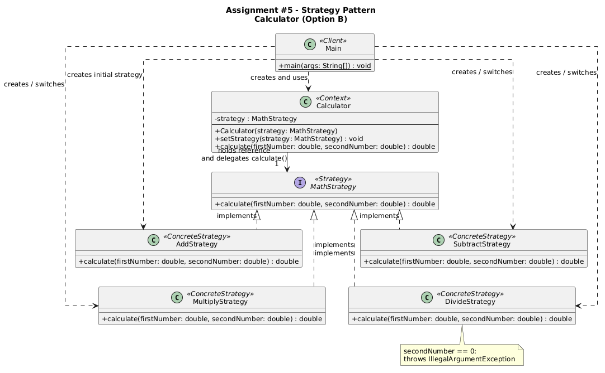

# Strategy Pattern - Calculator


## Project Overview

This project demonstrates the **Strategy Design Pattern** using a simple calculator. The calculator can perform four mathematical operations: addition, subtraction, multiplication, and division.

Each operation is a separate strategy. The `Calculator` class uses the `MathStrategy` interface, so it does not need `if-else` or `switch` statements to select an operation.

The program shows how to change a strategy at runtime without creating a new calculator.

## Role Map

| Role | Class | Source |
|---|---|---|
| Client | `Main` | `src/main/java/calculator/Main.java` |
| Context | `Calculator` | `src/main/java/calculator/Calculator.java` |
| Strategy interface | `MathStrategy` | `src/main/java/calculator/strategy/MathStrategy.java` |
| Concrete Strategy 1 | `AddStrategy` | `src/main/java/calculator/strategy/AddStrategy.java` |
| Concrete Strategy 2 | `SubtractStrategy` | `src/main/java/calculator/strategy/SubtractStrategy.java` |
| Concrete Strategy 3 | `MultiplyStrategy` | `src/main/java/calculator/strategy/MultiplyStrategy.java` |
| Concrete Strategy 4 | `DivideStrategy` | `src/main/java/calculator/strategy/DivideStrategy.java` |

## Strategy Structure

The `MathStrategy` interface declares the `calculate(double firstNumber, double secondNumber)` method. Each concrete strategy implements this method with its own mathematical operation.

The `Calculator` stores a reference to `MathStrategy` and calls its `calculate()` method. The client can change the current strategy using:

```java
calculator.setStrategy(new MultiplyStrategy());
```

In `Main`, the same `Calculator` object uses all four strategies one by one.

`DivideStrategy` checks if the second number is zero. If it is zero, the strategy throws an `IllegalArgumentException`. The client catches this exception and prints an error message.

## UML Class Diagram

The diagram shows the client, context, strategy interface, four concrete strategies, and the relationships between them.



## Build and Run

**Language:** Java 17

### IntelliJ IDEA

1. Open the project in **IntelliJ IDEA**.
2. Set the project SDK to **JDK 17**.
3. Open `src/main/java/calculator/Main.java`.
4. Run the `main()` method.

### Windows PowerShell (optional)

Run these commands from the project root:

```powershell
javac --release 17 -encoding UTF-8 -d out (Get-ChildItem -Path .\src\main\java -Filter *.java -Recurse | ForEach-Object { $_.FullName })
java -cp out calculator.Main
```

No external libraries or build tools are required.

## Expected Demonstration Result

The program uses the numbers `20` and `5` and changes the strategy during execution.

```text
Addition: 25.0
Subtraction: 15.0
Multiplication: 100.0
Division: 4.0
Division by zero: Cannot divide by zero.
```

The program ends successfully because the division-by-zero exception is handled.

## How to Add a New Strategy

For example, to add a power operation:

1. Create a new class called `PowerStrategy` in the `calculator.strategy` package.
2. Implement the `MathStrategy` interface.
3. Add the `calculate()` method with the new operation.
4. Create the new strategy in `Main` and pass it to `calculator.setStrategy()`.

There is no need to change the `Calculator` class or the existing strategies. This shows the **Open/Closed Principle**.
